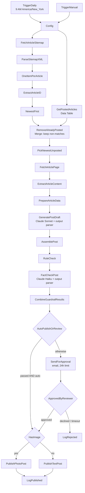

# PlacidWay Daily Facebook Post Automation

An n8n workflow that takes one published PlacidWay article each day and turns it into an on-brand Facebook post. Claude writes the draft. Two guardrail layers check it before anything goes out. The post is either published automatically or sent to a reviewer for approval first. Every run is logged, and a failure that survives retries sends an email alert.

This is the first version of a system that gives the PlacidWay marketing team one fresh post per day without copying and pasting.

---

## Contents

- [Architecture](#architecture)
- [How it works, step by step](#how-it-works-step-by-step)
- [Design decisions and trade-offs](#design-decisions-and-trade-offs)
- [Guardrails](#guardrails)
- [Setup](#setup)
- [Configuration and credentials](#configuration-and-credentials)
- [How to run](#how-to-run)
- [Logging and error handling](#logging-and-error-handling)
- [Sample output](#sample-output)
- [Limitations and next steps](#limitations-and-next-steps)
- [Files in this repo](#files-in-this-repo)

---

## Architecture



A separate workflow, **PlacidWay Error Alerts** (`OnWorkflowError → SendErrorAlert → LogFailure`), runs automatically when the main workflow fails.

---

## How it works, step by step

| Stage | Nodes | What happens |
|---|---|---|
| **Trigger** | `TriggerDaily`, `TriggerManual` | Runs once a day at 9 AM (America/New_York), or on demand for testing. |
| **Config** | `Config` | Holds every setting in one place: `publish_mode`, `reviewer_email`, `fb_page_id`. |
| **Find articles** | `FetchArticleSitemap` → `ParseSitemapXML` → `OneItemPerArticle` | Downloads PlacidWay's article sitemap in a single request and turns it into one item per article (about 5,170). |
| **Select** | `ExtractArticleID` → `NewestFirst` → `RemoveAlreadyPosted` → `PickNewestUnposted` | Pulls the numeric ID from each article URL, sorts newest first, drops any URL already in the log, and keeps one. |
| **Extract** | `FetchArticlePage` → `ExtractArticleContent` → `PrepareArticleData` | Fetches only the chosen article and extracts the title (`h1.main-heading`), summary (meta description), featured image (`og:image`, 1200×630) and body text. Then it cleans the body. |
| **Generate** | `GeneratePostDraft` (+ `ClaudeSonnet`, `ValidatePostStructure`) → `AssemblePost` | Claude returns structured parts (hook, 2–3 lines, CTA, hashtags), which a schema validates. The workflow assembles the final post and inserts the real link itself. |
| **Guardrails** | `RuleCheck` → `FactCheckPost` (+ `ClaudeHaikuChecker`, `ValidateFactCheck`) → `CombineGuardrailResults` | A rule-based check plus a second-LLM fact check. See [Guardrails](#guardrails). |
| **Route** | `AutoPublishOrReview` | The post publishes automatically **only if** both guardrails pass **and** `publish_mode = auto`. Every other case goes to a human. |
| **Review** | `SendForApproval` → `ApprovedByReviewer` | Emails the draft, image, guardrail result and source link with Approve / Decline buttons. The workflow waits up to 24 hours. |
| **Publish** | `HasImage` → `PublishPhotoPost` / `PublishTextPost` | Posts to the Facebook Page through the Graph API. It uses a photo post when an image exists and falls back to a text + link post when it doesn't. |
| **Log** | `LogPublished`, `LogRejected` | Writes the article, post text, Facebook post ID and status to the `placidway_post_log` Data Table. |

---

## Design decisions and trade-offs

**Sitemap + HTML parsing instead of RSS or a headless browser**
- `robots.txt` points to an official sitemap index. The articles sitemap (`/1/sitemap_articles.xml`) lists every article in one file, so a single request finds all candidates.
- Only the one chosen article page is fetched after that, so each run makes **2 requests to PlacidWay**, well within the 1-request-per-second rule.
- A headless browser would be slower and heavier, and the pages render fine without JavaScript.
- `robots.txt` allows `/article/`. Sitemaps for search, pricing and translations were deliberately skipped.

**Selecting by article ID, not `lastmod`**
- Thousands of articles share the same `lastmod` date, which suggests bulk updates, so it can't identify new content.
- Article IDs increase as articles are published, so "highest ID not yet posted" reliably means "newest unposted article."

**`og:image` over the sitemap thumbnail**
- The sitemap includes a thumbnail. The page's `og:image` is the version Facebook itself uses for shares, already sized at 1200×630. The thumbnail is kept as a fallback.

**Claude returns parts, and the workflow assembles the post**
- The model never writes the URL, so the link is always the real source and can't be hallucinated.
- Each part can be checked separately, and the character count is measured in code. Language models are unreliable at counting.

**Basic LLM Chain + Structured Output Parser**
- The response is validated against a schema before anything else runs.
- The chat model is a separate sub-node, so it can be swapped without touching the rest of the workflow.

**Two different models**
- Claude Sonnet writes. Claude Haiku reviews. The reviewer is independent of the writer, and checking is a simpler task than writing, so the smaller, cheaper model is enough.

**Thinking mode set to Adaptive**
- With "disabled," the n8n Anthropic Chat Model node sends a parameter the newest Claude models reject (HTTP 400). Adaptive lets the model decide whether to reason, which for a short post keeps cost and latency low.

**One Data Table for dedupe and the log**
- The same table that records each run is the "already posted" store. Rejected articles are logged too, so the workflow doesn't propose the same rejected article every day.

---

## Guardrails

Healthcare content carries real risk: outcome claims, wrong prices, or details that aren't in the source can mislead patients and break platform health policies. So there are two layers, and the post must pass both to publish automatically.

**Layer 1: `RuleCheck` (rule-based, instant, free)**

Checks the text before the link for:

| Rule | Why |
|---|---|
| Under 500 characters before the link | Assessment requirement |
| 3–5 hashtags | Assessment requirement |
| No prices, currencies or cost words (`$`, `USD`, `THB`, `price`, `cost`, `discount`, …) | Prevents invented or misquoted prices |
| No claim words (`cure`, `guaranteed`, `proven`, `best`, `permanent`, `risk-free`, `painless`, …) | Prevents medical claims and outcome promises |
| No "100%" or "no side effects" | Absolute claims are never acceptable |
| Exactly one link | Confirms the real source URL is present once |

**Layer 2: `FactCheckPost` (second LLM pass)**

Claude Haiku compares the post with the source article and fails it if it:
1. states anything not found in the article,
2. makes a medical claim or implies an outcome,
3. mentions a price, or
4. is misleading or overstates the article.

The reviewer is told *"if unsure, fail it."* In healthcare, blocking a good post occasionally is better than publishing a bad one.

**What happens on a failure:** the post is **never auto-published**. It goes to the human reviewer with the issues listed in the email.

**Two real catches during development**
1. **Misleading by omission.** An early draft mentioned systemic stem cell options for joint pain without the article's caveat that those programs aren't listed for joint pain and that the evidence isn't established. `FactCheckPost` failed it. Fix: a "keep the article's caveats" rule in the generation prompt.
2. **Too long.** After that fix, one draft came out at 517 characters before the link. `RuleCheck` caught it. Fix: per-part length limits in the prompt (hook < 80, 2–3 lines < 110 each, CTA < 70), which the model follows more reliably than a total count.

Each layer caught a different kind of problem, which is why both exist.

---

## Setup

**Requirements**
- n8n 2.x (built on **2.29.10**, self-hosted in Docker)
- An Anthropic API key (Claude)
- A Facebook account, a **test Page you own**, and a Meta Developer app
- An email account for sending approval requests and alerts (Gmail SMTP with an App Password works)

**1. Run n8n**
```bash
docker run -d --name n8n --restart unless-stopped -p 5678:5678 \
  -v n8n_data:/home/node/.n8n docker.n8n.io/n8nio/n8n
```
Then open `http://localhost:5678`.

**2. Create the Data Table** (Data Tables aren't included in workflow exports)

Name: `placidway_post_log`

| Column | Type |
|---|---|
| `article_id` | Number |
| `url` | String |
| `title` | String |
| `post_text` | String |
| `fb_post_id` | String |
| `status` | String |
| `error` | String |

n8n adds `createdAt` and `updatedAt` automatically.

**3. Create the credentials** (see below).

**4. Import both workflows**
- Import `placidway-error-alerts.json` and `placidway-daily-facebook-post.json`.
- Reconnect each node to your credentials and to the `placidway_post_log` table.
- Replace the placeholder emails (`reviewer@example.com`, `sender@example.com`).
- Publish **PlacidWay Error Alerts**, then in the main workflow open **Settings → Error Workflow** and select it.
- In **Settings → Timezone**, choose `America/New_York` (or your own named timezone).

**5. Publish the main workflow** so the daily schedule runs.

---

## Configuration and credentials

**Settings: the `Config` node**

| Setting | Example | Meaning |
|---|---|---|
| `publish_mode` | `approval` | `approval`: a human approves every post. `auto`: posts that pass both guardrails publish automatically, and failures still go to a human. |
| `reviewer_email` | `reviewer@example.com` | Receives approval requests |
| `fb_page_id` | `1481298111724805` | The Facebook Page to post to (the demo test Page) |

**Secrets: n8n credentials (never stored in the workflow)**

| Credential | Type | Notes |
|---|---|---|
| Anthropic | Anthropic API | Your Claude API key |
| `Facebook Test Page` | Facebook Graph API | A **long-lived Page access token** (Expires: Never). Allowed domains restricted to `graph.facebook.com`. |
| SMTP | SMTP | e.g. `smtp.gmail.com`, port 465, SSL, with a Gmail **App Password** |

**Getting a long-lived Facebook Page token**
1. In Graph API Explorer, generate a **User** token with `pages_show_list`, `pages_manage_posts` and `pages_read_engagement`.
2. Open it in the Access Token Tool and click **Extend Access Token**.
3. Put the extended user token back in the Explorer and call `GET me/accounts`.
4. Copy the `access_token` inside your Page's entry. Check it in the Access Token Debugger: it should show **Type: Page, Expires: Never**.

Use the **Page** token, not the user token. Posting with a user token fails with a deprecated `publish_actions` permission error.

---

## How to run

- **Test run:** open the main workflow and click **Execute workflow** (TriggerManual).
- **Daily run:** publish the workflow. `TriggerDaily` fires at 9 AM in the workflow's timezone.
- **Approval mode:** the reviewer gets an email and clicks **Approve** or **Decline**. With no response in 24 hours, nothing is published and the run is logged as rejected.
- **Auto mode:** set `publish_mode` to `auto` in `Config`. Posts that pass both guardrails publish without an email.

---

## Logging and error handling

**Run log:** every outcome is written to `placidway_post_log`:
- `published`: article, post text and Facebook post ID
- `rejected`: declined or not answered within 24 hours, with the guardrail issues if any
- `failed`: written by the error workflow, with the failed node and error message

**Retries**

| Nodes | Tries | Wait | Why |
|---|---|---|---|
| `FetchArticleSitemap`, `FetchArticlePage` | 3 | 5 s | The site may be briefly unavailable. The wait respects the rate limit. |
| `GeneratePostDraft`, `FactCheckPost` | 3 | 5 s | Claude may be busy or rate-limited |
| `PublishPhotoPost`, `PublishTextPost` | 2 | 5 s | Publishing isn't idempotent. If Facebook published but the response was lost, more retries would create duplicate posts. Publish errors are also usually permanent (an expired token or missing permission). |

n8n caps the retry wait at 5 seconds. For longer outages, the run fails and alerts a human instead of looping.

**Alerts:** when a node still fails after its retries, the workflow stops (nothing half-finished is published), and **PlacidWay Error Alerts** emails the workflow name, failed node, error message and a link to the execution, then logs a `failed` row.

Error Triggers only fire on automatic runs, not manual ones. The alert path was tested with a throwaway scheduled workflow that deliberately fails (a Stop and Error node simulating "sitemap unreachable"). That's the `failed` row in `sample-posts.csv`.

---

## Sample output

Three posts generated from real PlacidWay articles and published to the test Page **Automation test 0617**:

**1. Article 9853:** [Chronic Pain Across Several Joints: Local and Systemic Stem Cell Options at a Bangkok Longevity Center](https://www.placidway.com/article/9853/Chronic-Pain-Across-Several-Joints-Local-and-Systemic-Stem-Cell-Options-at-a-Bangkok-Longevity-Center)
Facebook post ID: `1481298111724805_122105640843539388`
```
Pain in several joints? The questions change.

Learn how local (single-joint) and systemic stem cell options differ at a Bangkok longevity center.
Evidence for systemic cells in multi-joint pain is not established, and these protocols are investigational.
A physician decides eligibility after assessment, and sometimes the answer is no.

Read the full guide to explore the questions to ask.

https://www.placidway.com/article/9853/Chronic-Pain-Across-Several-Joints-Local-and-Systemic-Stem-Cell-Options-at-a-Bangkok-Longevity-Center

#JointPain #StemCellTherapy #Bangkok #MedicalTourism #PlacidWay
```

**2. Article 9852:** [Persistent Fatigue and Slow Recovery: How Physicians Approach 50M, 70M and 100M UC-MSC IV Protocols in Bangkok](https://www.placidway.com/article/9852/Persistent-Fatigue-and-Slow-Recovery-How-Physicians-Approach-50M-70M-and-100M-UC-MSC-IV-Protocols-in-Bangkok)
Facebook post ID: `1481298111724805_122105648649539388`
```
Tired for months? Fatigue is a symptom, not a diagnosis.

Physicians at Healthi Life in Bangkok start with a medical workup before considering UC-MSC IV protocols.
Stem cell therapy here is investigational, and outcomes vary and are not guaranteed.
The workup may find a treatable cause, and eligibility is always confirmed by a physician.

Read the full guide to learn how the assessment works.

https://www.placidway.com/article/9852/Persistent-Fatigue-and-Slow-Recovery-How-Physicians-Approach-50M-70M-and-100M-UC-MSC-IV-Protocols-in-Bangkok

#PersistentFatigue #StemCellTherapy #Bangkok #PlacidWay #MedicalTourism
```

**3. Article 9851:** [Stem Cell Therapy for Hair Density in Bangkok: Who It May Suit and What to Ask First](https://www.placidway.com/article/9851/Stem-Cell-Therapy-for-Hair-Density-in-Bangkok-Who-It-May-Suit-and-What-to-Ask-First)
Facebook post ID: `1481298111724805_122105670597539388`
```
Thinking about stem cell therapy for hair density? Start here.

Hair thinning has many causes, so the guide stresses a medical assessment before any treatment.
The therapy is investigational. Outcomes vary and are not guaranteed, and a physician confirms eligibility.
Learn who it may suit and which questions to ask a physician in Bangkok before you decide.

Read the full guide to prepare for your consultation.

https://www.placidway.com/article/9851/Stem-Cell-Therapy-for-Hair-Density-in-Bangkok-Who-It-May-Suit-and-What-to-Ask-First

#HairThinning #StemCellTherapy #Bangkok #PlacidWay #MedicalTourism
```

All three keep the source article's caveats ("investigational", "outcomes vary", "a physician confirms eligibility") and contain no prices, even though the source articles include them.

The full run log, including the simulated failure, is in `sample-posts.csv`.

---

## Limitations and next steps

- **Local approval links.** The Approve / Decline buttons point to `localhost:5678`, so they only work on the machine running n8n. In production, n8n would run on a public URL with HTTPS.
- **Config lives in the workflow.** Switching between auto and approval means editing the `Config` node. Next step: move these settings to a small settings table or environment variables, so the marketing team can change them without opening n8n.
- **Selector dependency.** The title selector (`h1.main-heading`) would need updating if PlacidWay redesigns its article pages. The meta description and `og:image` are standard tags and more stable.
- **No automatic rewrite.** A failed draft goes to a human. A next step would be one automatic regeneration with the guardrail issues as feedback before falling back to review.
- **One content type.** Only articles are used. The sitemap index also has packages, patient Q&A and news, which would allow the "rotate content types across the week" stretch goal.
- **Token lifecycle.** A long-lived Page token stops working if the Page admin changes their password or removes the app. The error workflow would alert on that, but renewal is manual.

Stretch goals (cross-posting, image branding, dashboard, engagement read-back) were not implemented in this version.

---

## Files in this repo

| File | Contents |
|---|---|
| `placidway-daily-facebook-post.json` | Main workflow export |
| `placidway-error-alerts.json` | Error workflow export |
| `sample-posts.csv` | Run log export: 3 published posts and 1 simulated failure |
| `README.md` | This document |

Workflow exports contain no credentials. Email addresses have been replaced with placeholders.
